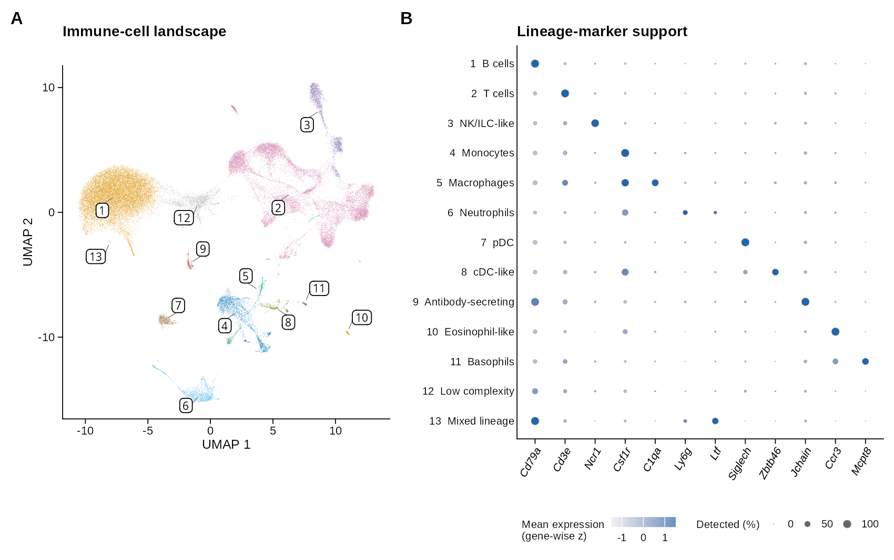
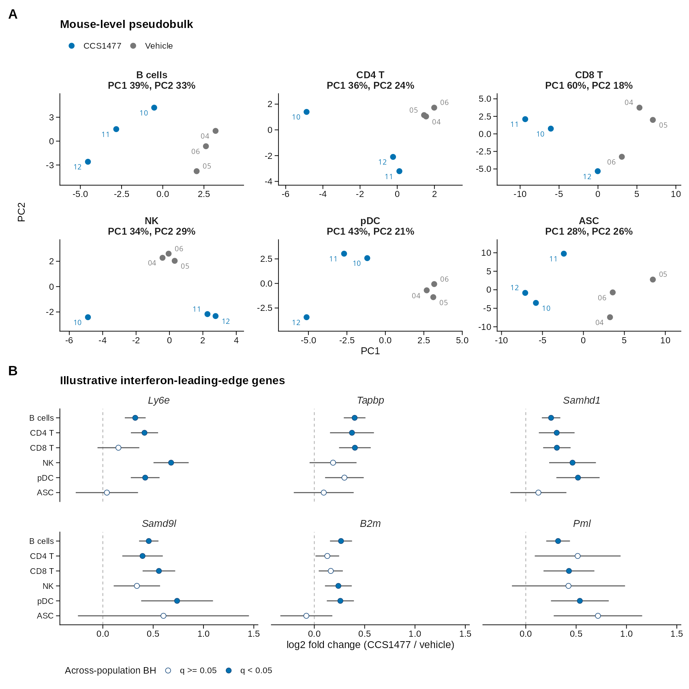
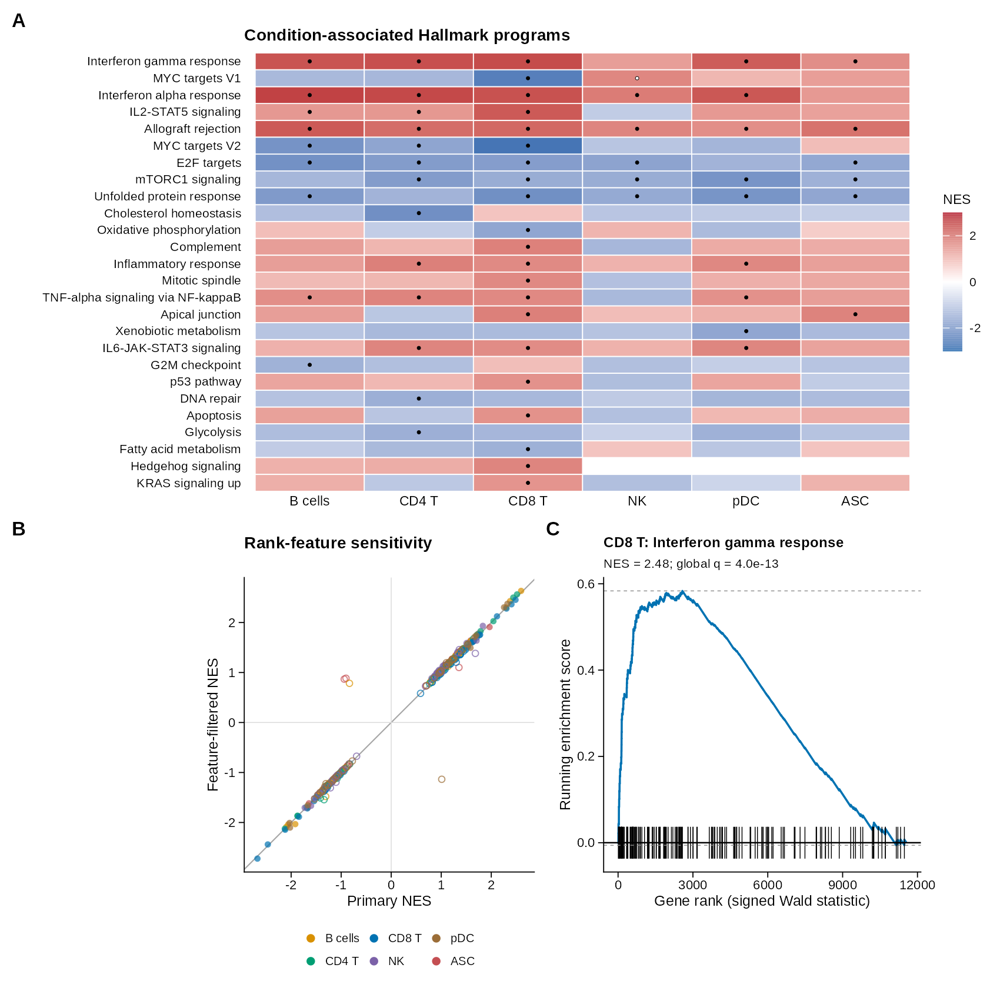
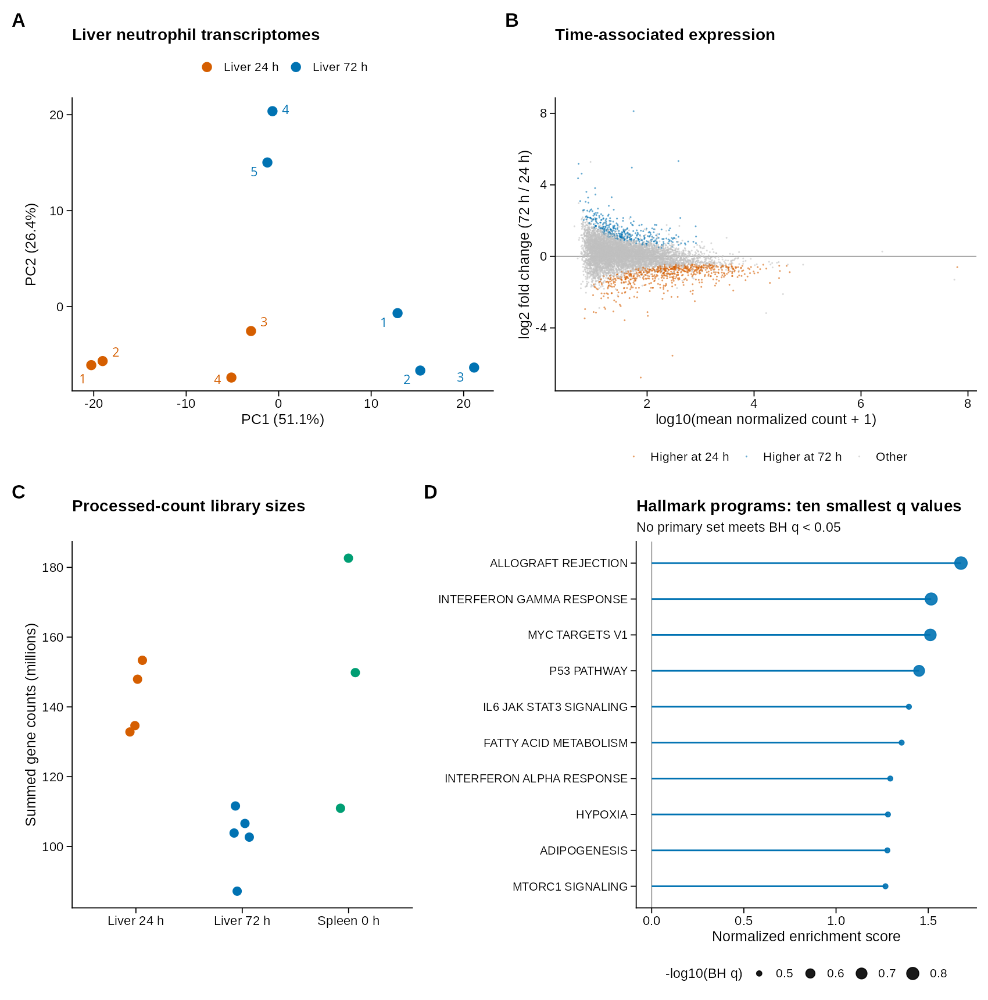

# Liver immune transcriptomics

A public-data bioinformatics portfolio using reproducible R/Seurat, DESeq2 and Python workflows. The single-cell project profiles mouse liver immune populations in acute-on-chronic liver failure; a second bulk RNA-seq project examines liver neutrophils during injury and repair. These are independent reanalyses of submitter-processed GEO counts, with original data generators credited throughout.

## Single-cell project

[GSE338157](https://www.ncbi.nlm.nih.gov/geo/query/acc.cgi?acc=GSE338157) contains three sample-tagged mice per condition: fibrosis, ACLF plus vehicle, and ACLF plus CCS1477. The retained atlas contains **44,188 cells across nine mouse tags**. Conservative selection supports mouse-level pseudobulk comparisons in six reviewed populations. Unresolved lineages and rate-sensitive doublet calls are explicitly tracked.

**Study-design limit:** each condition has one multiplexed capture library. Condition and capture are confounded. Expression and pathway results are exploratory associations, not independently validated or capture-adjusted drug effects.

### Figure 1. Cell atlas and marker support

[](figures/publication/Figure_1_cell_atlas.pdf)

Provisional broad immune populations and canonical lineage-marker expression. Unresolved cells remain visible rather than being assigned confident identities.

### Figure 2. Mouse-level expression

[](figures/publication/Figure_2_mouse_level_expression.pdf)

Each PCA point is a mouse tag, with three mice per treatment group. Illustrative interferon-leading-edge genes are shown with pointwise Wald intervals; gene selection is documented and is not independent validation.

### Figure 3. Hallmark enrichment and sensitivity

[](figures/publication/Figure_3_hallmark_programs.pdf)

All 26 Hallmark gene sets associated in at least one primary population are displayed. Of 64 primary gene-set/population associations, 63 retain direction and adjusted-P support after the specified rank-feature filter. This sensitivity check does not remove capture confounding.

The [complete captions](figures/CAPTIONS.md) define sample sizes, thresholds, tests, selection rules and interpretation limits. [Publication files](figures/publication/) include embedded-font vector PDF, editable SVG and 600 dpi PNG; [source data](figures/source_data/) support every panel. Technical diagnostics are presented in [Supplementary Figure S1](figures/publication/Supplementary_Figure_S1_technical_audit.pdf), separate from the main figure set.

## Bulk RNA-seq project

[GSE247373](https://www.ncbi.nlm.nih.gov/geo/query/acc.cgi?acc=GSE247373) provides mouse neutrophil counts for spleen controls and liver samples after CCl4 injury. The curated DESeq2 contrast compares liver 72h (five libraries) with liver 24h (four libraries). Individual-mouse provenance/pooling per library remains unverified. Spleen comparisons are excluded from the primary model because they conflate tissue and treatment/time. The analysis identifies 1,002 time-associated features (BH q<0.05), all retaining direction in nine leave-one-library-out fits. No primary Hallmark set meets BH q<0.05. [Methods and limitations](docs/BULK_ANALYSIS.md) explain identifier mapping, model checks and the descriptive cross-study context.

[](figures/publication/Bulk_Figure_1_expression_and_programs.pdf)

The [bulk sensitivity figure](figures/publication/Bulk_Supplementary_Figure_S1_sensitivity.pdf) shows omission fits and rank-feature sensitivity.

## Reproduce

Use R 4.5.2 and Python 3.11+. Restore the locked project library before running R analyses; the launcher explicitly selects it. Python download/conversion scripts use the standard library. Figure-export QA additionally uses Poppler tools (`pdfinfo`, `pdffonts`, `pdfimages`). An isolated library with all 219 exact locked versions passed validation, and an independent bulk rerun reproduced all 14 CSV tables byte-for-byte. That library reused locally installed packages; an entirely fresh source-download installation and full single-cell recomputation remain unverified. See the [release status](docs/RELEASE_STATUS.md).

```bash
Rscript -e 'install.packages("renv", repos="https://cloud.r-project.org"); renv::restore()'
python3 -m unittest discover -s tests -v
python3 scripts/download.py
python3 scripts/convert_sc.py
python3 scripts/validate_inputs.py
Rscript scripts/run_r.R scripts/sc_analysis.R
bash scripts/run_sc_review.sh
bash scripts/run_sc_sensitivity.sh
bash scripts/run_sc_pseudobulk.sh
bash scripts/run_publication_figures.sh
bash scripts/run_bulk.sh
```

The figure source tables are committed, so final figures can also be regenerated directly with `Rscript scripts/run_r.R scripts/publication_figures.R` after restoring dependencies. Earlier stages require the downloaded public matrices and regenerated Seurat objects. Large matrices and R objects are excluded from version control. `celltypes_consensus.tsv` is guarded by a cell-to-cluster fingerprint: if recomputation changes assignments, review the mapping before applying it.
