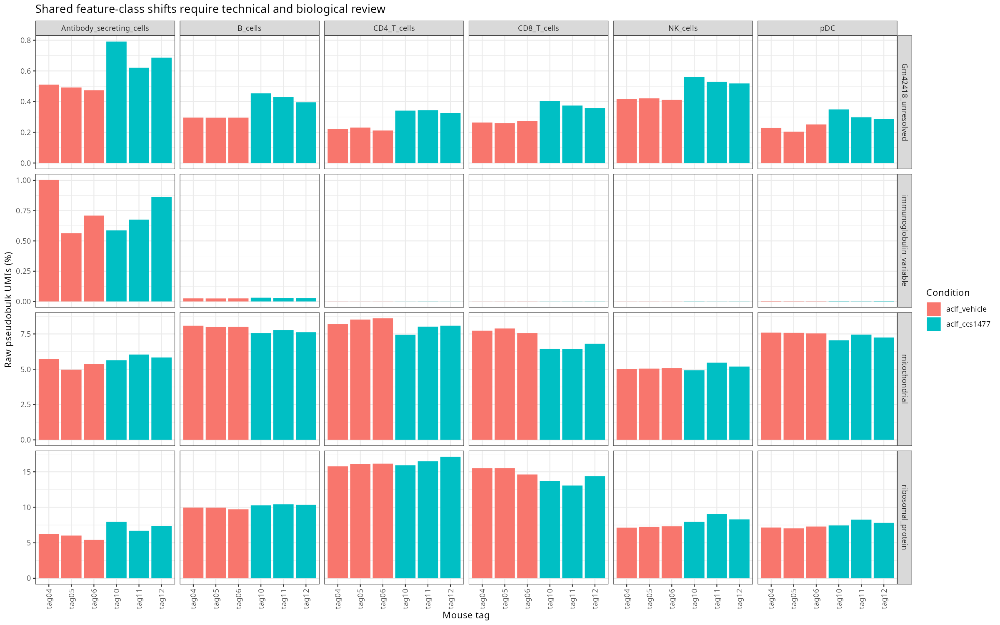
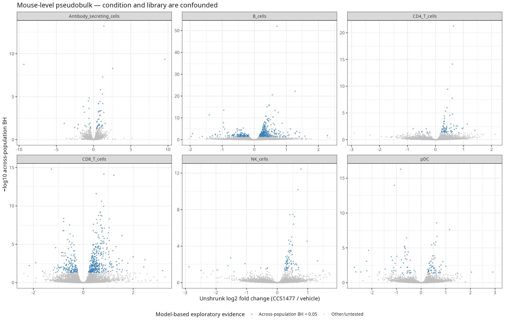

# Exploratory mouse-level pseudobulk — CCS1477 versus vehicle

**Interpretation limit:** condition and capture library are completely confounded. There is one capture library per condition, with three mouse sample tags in each. Mouse-level aggregation avoids treating cells as independent replicates; it does not create replicate libraries or identify a library-adjusted drug effect. All P values and adjusted P values below are conditional on the stated model, not confirmatory evidence of efficacy.

Dataset: independent reanalysis of public mouse liver CD45+ immune-cell counts from [GSE338157](https://www.ncbi.nlm.nih.gov/geo/query/acc.cgi?acc=GSE338157). No unpublished inputs are used.

## Cell-selection freeze

30,171 cells across all nine mouse tags were assigned to eight prespecified high-confidence populations. Each retained cell must have no baseline or new-cluster hold, no rate-sensitive model call and no strong same-cell B/T marker conflict. All cells had already passed the ≥500-gene branch and consensus doublet exclusion. The selection is conservative and does not prove all retained cells are singlets.

The population map is `config/pseudobulk_populations.tsv`; the frozen per-cell decision and one hierarchical exclusion reason are in `results/sc/pseudobulk/cell_selection.csv.gz`. Earlier reasons take priority when a cell fails multiple rules. Moderate/low-confidence populations are outside the primary analysis, even if plausible biological labels exist. The two excluded sparse populations refer to the reviewed Ltf/Ngp-rich neutrophil subset and basophils; no claim is made that all neutrophils are too sparse.

| Selection outcome | Cells |
|---|---:|
| included | 30,171 |
| outside_prespecified_reviewed_populations | 13,178 |
| rate_sensitive_doublet_call | 576 |
| strong_B_T_marker_conflict | 87 |
| unresolved_review_hold | 176 |

## Replicates and eligibility

Raw integer UMI counts were summed by population and mouse sample tag. The 72 aggregates preserve eight populations × nine mouse tags. Fibrosis samples are retained in the aggregate/provenance tables but are not tested in this primary contrast. No zero-expression sample is invented to replace an absent population.

A population is tested only if **all six** ACLF mice have at least 20 selected cells and 10,000 summed UMIs. There are no dropped outlier mice, no pooling of mouse tags and no cell-level treatment test. The source GEO design describes the tags as biological mice; the analysis cannot independently verify that description.

| Population | Tested | Minimum cells among six mice | Minimum UMIs | Reason |
|---|---|---:|---:|---|
| B_cells | TRUE | 1823 | 12,786,422 | six_mice_pass |
| CD4_T_cells | TRUE | 207 | 1,697,741 | six_mice_pass |
| CD8_T_cells | TRUE | 606 | 5,609,372 | six_mice_pass |
| NK_cells | TRUE | 82 | 700,514 | six_mice_pass |
| pDC | TRUE | 57 | 836,629 | six_mice_pass |
| Antibody_secreting_cells | TRUE | 24 | 548,503 | six_mice_pass |
| Ltf_Ngp_neutrophils | FALSE | 7 | 101,954 | insufficient_cells_or_umi_in_at_least_one_mouse |
| Basophils | FALSE | 3 | 23,046 | insufficient_cells_or_umi_in_at_least_one_mouse |

## Model and multiple testing

- DESeq2 1.48.2, design `~ condition`, unpaired three CCS1477 and three vehicle mouse tags; positive log2 fold change means higher in CCS1477.
- Including capture together with condition is rank-deficient. This is explicitly checked and exported for every tested population; no unidentifiable batch term is fitted.
- Genes require ≥10 raw counts in at least three of the six mice. Size factors use `poscounts`; coefficient estimates are unshrunk. No normalized values are passed as count inputs.
- Wald testing uses alpha=0.05, standard independent filtering and Cook outlier handling. Automatic count replacement is disabled. Failed coefficient convergence, if present, is not treated as a successful test.
- `padj` is the DESeq2 within-population adjusted value. `padj_across_populations` applies BH jointly to the nonmissing P values from all six tested populations in this single contrast. Gene–population pairs are distinct tests, not necessarily distinct genes.
- Six leave-one-mouse-out fits use the same prefiltered gene set with two versus three mice. The exported direction counts and LFC ranges measure sensitivity to omission, not repeat significance or correction for shared-library effects. No LOO P value is used as an extra discovery test.

| Population | Prefiltered genes | Nonmissing P values | Within-population BH <0.05 | Across-population BH <0.05 | Same LFC direction in all six omission fits, among across-population discoveries |
|---|---:|---:|---:|---:|---:|
| Antibody_secreting_cells | 6918 | 6915 | 66 | 62 | 62 |
| B_cells | 13280 | 13280 | 674 | 491 | 491 |
| CD4_T_cells | 9709 | 9709 | 88 | 81 | 81 |
| CD8_T_cells | 11559 | 11557 | 742 | 538 | 538 |
| NK_cells | 8654 | 8653 | 93 | 86 | 86 |
| pDC | 8670 | 8667 | 112 | 110 | 110 |

The model yields 1,368 gene–population pairs at across-population BH <0.05, representing 1,050 unique gene symbols. These totals are descriptive model outputs and are not a score for portfolio quality or evidence of causal treatment activity.

## Sample coverage of tested populations

| Population | VEH tag04 | VEH tag05 | VEH tag06 | CCS tag10 | CCS tag11 | CCS tag12 |
|---|---:|---:|---:|---:|---:|---:|
| B_cells | 2341 | 2150 | 2517 | 2359 | 1823 | 2485 |
| CD4_T_cells | 376 | 314 | 284 | 207 | 267 | 314 |
| CD8_T_cells | 689 | 606 | 742 | 641 | 847 | 740 |
| NK_cells | 218 | 193 | 160 | 82 | 135 | 118 |
| pDC | 72 | 62 | 90 | 85 | 77 | 57 |
| Antibody_secreting_cells | 39 | 24 | 41 | 29 | 39 | 42 |

## Diagnostic interpretation

Volcano facets use separate axis ranges; fold changes remain unshrunk. Several top-ranked features recur across populations, including mt-Nd4l and Gm42418. Gm42418 is retained as an unresolved feature annotation; no function is assigned here. Ribosomal-protein features also appear among the NK/T-cell results. Antibody-secreting-cell rankings include immunoglobulin-variable genes, whose variation can reflect repertoire or state composition. A B-cell Ccl5 signal alone does not establish B-cell-specific chemokine regulation and merits ambient/mixed-cell review. None of these signals is automatically deleted from the statistical tables. Total mitochondrial UMI fractions do not rise uniformly across populations even though mt-Nd4l has a positive modeled coefficient in all six; one mitochondrial gene should not be treated as a complete mitochondrial program.

The feature-class audit reports raw UMI fractions for mitochondrial symbols (`^mt-`), an operational, non-exhaustive ribosomal-protein symbol set (`^Rp[sl][0-9]`), immunoglobulin-variable symbols (`^Ig[hkl]v`) and Gm42418 separately. Shared shifts can arise from technical differences or broad biological states. Because all populations in each condition share a capture library, cross-population recurrence and stable mouse-omission directions do not resolve that ambiguity.

## Figures and tables

Each tested population directory contains sample-labelled PCA, VST sample distances, a heatmap of the top 20 model-ranked genes, raw-model results, normalized counts, size factors and six omission-fit LFC columns. Heatmap colors are row-scaled VST values, not fold changes; gene ranking is derived from these same data and is not an independent validation. Mice are labelled explicitly so within-group heterogeneity remains visible.

The complete joined result is `results/sc/pseudobulk/all_tested_populations_de.csv`. `gene_feature_flags.csv` labels the operational feature classes, and `shared_model_associations.csv` lists features associated in at least three populations. No pathway enrichment or target-mechanism claim is made at this stage.

## Reproduce and validation

After a successful `renv::restore()`, run `bash scripts/run_sc_pseudobulk.sh`. Its R launcher explicitly selects the restored project library. Current execution used the isolated matching library. Fresh-environment restoration remains a separate release check.

Aggregation checks conserve included cells and gene-wise raw UMI totals. Independent tests spot-check marker counts against the source Seurat count layer, verify the six biological sample units and contrast direction, reconcile selection and coverage, and check the across-population BH family and omission-fit accounting. Source/annotation/map hashes and package session records accompany the outputs.

## Next interpretation work

Review shared mitochondrial/ribosomal/Gm42418 signals and sample QC before interpreting pathway rankings. Inspect broad B/CD8 state composition and candidate gene expression in individual mice. If pathway analysis is pursued, use the actual tested-gene universe, retain the confounding caveat, and distinguish exploratory hypotheses from mechanisms. An independent study would be needed to test whether these patterns generalize.

Method reference: [DESeq2 documentation](https://bioconductor.org/packages/release/bioc/vignettes/DESeq2/inst/doc/DESeq2.html), including raw-count input, model-rank limitations and sample-level analysis. The executed package is the locked 1.48.2 version; the release website may describe a newer version.
