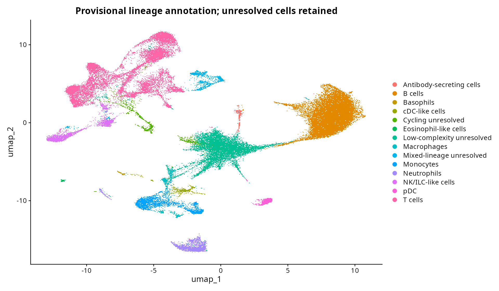
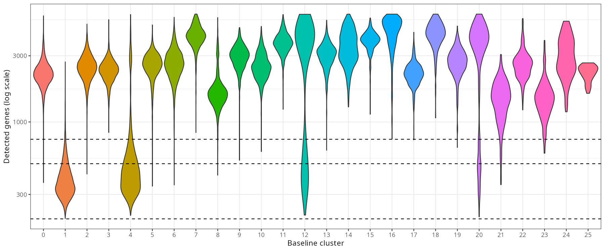

# Single-cell QC and provisional annotation — 3 November 2026

This is the first-pass review snapshot. See the [completed doublet sensitivity and reclustering stage](SC_SENSITIVITY.md) for the latest status.

## Decision

Keep the original 200–6,000 detected-gene / ≤20% mitochondrial baseline unchanged. The 500-gene threshold is the preferred **candidate for a separate QC rerun**, because it primarily removes low-complexity unresolved populations while retaining almost all cells in most marker-defined lineages. Do not overwrite the baseline, assume cluster IDs survive reclustering, or compare treatment groups before reviewing that rerun and within-tag doublets.

Baseline: 55,634 cells across nine mouse tags. Five clusters (1, 4, 11, 12, 25), totaling 12,849 cells (23.1%), are held from condition analysis because of low complexity, conflicting lineage, or unresolved cycling lineage. Other labels are provisional lineage assignments, not proof of singlet status.

## Sample QC

| Mouse tag | Before | Retained | Retained % | Median genes | Median UMIs | Median mitochondrial % |
|---|---:|---:|---:|---:|---:|---:|
| tag01 | 4,701 | 4,654 | 99.0 | 2446 | 7684 | 7.71 |
| tag02 | 4,701 | 4,620 | 98.3 | 2476 | 7694 | 6.67 |
| tag03 | 4,797 | 4,734 | 98.7 | 2513 | 7697 | 5.70 |
| tag04 | 6,967 | 6,750 | 96.9 | 2184 | 6210 | 6.90 |
| tag05 | 7,031 | 6,848 | 97.4 | 2150 | 6066 | 6.49 |
| tag06 | 7,309 | 7,110 | 97.3 | 2122 | 5849 | 6.72 |
| tag10 | 6,720 | 6,518 | 97.0 | 2279 | 6583 | 6.35 |
| tag11 | 6,414 | 6,199 | 96.6 | 2189 | 6171 | 6.26 |
| tag12 | 8,399 | 8,201 | 97.6 | 2058 | 5620 | 6.12 |

All nine samples retain ≥96.6% of cells under the initial thresholds. High retention does not establish good quality: the initial cutoff admits large populations with very low RNA complexity. Mitochondrial medians alone do not identify those populations.

## Threshold sensitivity

| Minimum detected genes | Retained cells | Sample retention range |
|---|---:|---|
| 200 | 55,634 | 96.6–99.0% |
| 500 | 46,954 | 70.4–99.0% |
| 750 | 45,218 | 64.9–99.0% |

Cluster 1 has median 359 genes / 825 UMIs; cluster 4 has median 427.5 genes / 938.5 UMIs. Only 15.3% and 34.4%, respectively, pass 500 genes. They are concentrated in the ACLF vehicle and CCS1477 libraries, so a stricter threshold changes group representation. Remaining low-complexity cells should not automatically inherit an apparently normal lineage label. The 500-gene threshold also affects cycling cells and antibody-secreting cells and must be rechecked after reclustering.

## Conflicting-lineage evidence

The stronger B/T screen requires at least two of Cd79a/Cd79b/Ms4a1 and at least two of Cd3d/Cd3e/Trac each to have ≥2 raw UMIs in the **same barcode**. Cluster 11 passes at 86.7%, versus 0.15% in the main B cluster. Its median marker sums are 39 B-lineage and 22 T-lineage UMIs. This supports a mixed-lineage/doublet candidate annotation, not an activated CD4 identity. It does not prove doublets: physical cell conjugates or other mixed-cell events remain possible.

Cluster 25 has 41 cells, strong B markers and a granulocyte transcript program (median 38 B marker and 33 granulocyte marker UMIs). Hold it as unresolved: ambient contamination and mixed barcodes cannot be distinguished here. The broad ≥1-UMI discordant-lineage screen is deliberately sensitive and can flag ambient RNA, especially in high-RNA myeloid populations; it is **not** a calibrated doublet classifier and does not justify automatic removal.

## Provisional annotation

Confidence describes lineage-marker agreement, not doublet-free status. Numeric clusters remain unchanged. Dot-plot colors are scaled within each gene and should not be interpreted as absolute expression comparisons between genes. Detailed support and conflicts are in `config/celltypes.tsv`; quantitative detection fractions and mean log-expression are in `results/sc/review/panel_evidence.csv`. The exported cell metadata can be joined to the baseline Seurat object by `cell_id`.

| Cluster | Cells | Label | Confidence | Review status |
|---|---:|---|---|---|
| 0 | 17,734 | B cells | high | provisional_lineage |
| 1 | 7,993 | Low-complexity lymphoid (unresolved) | low | hold_low_complexity |
| 2 | 5,583 | Cytotoxic CD8 T cells | high | provisional_lineage |
| 3 | 2,510 | TCF7+ CD4 T cells | high | provisional_lineage |
| 4 | 2,462 | Low-complexity myeloid-like (unresolved) | low | hold_low_complexity |
| 5 | 2,295 | TCF7+ CD8 T cells | high | provisional_lineage |
| 6 | 2,188 | CD4 T cells (Treg-enriched) | moderate | provisional_lineage |
| 7 | 2,038 | Chil3+ monocytes/macrophage-like cells | moderate | provisional_lineage |
| 8 | 1,718 | S100a8+ neutrophils | moderate | provisional_lineage |
| 9 | 1,525 | Innate-like/cytotoxic T cells (subtype unresolved) | moderate | provisional_lineage |
| 10 | 1,317 | NK cells | high | provisional_lineage |
| 11 | 1,278 | Mixed B/T lineage (doublet candidate) | high | hold_mixed_lineage |
| 12 | 1,075 | Cycling lymphocytes (T-enriched) | moderate | hold_state_lineage |
| 13 | 950 | NK/ILC-like cells (subtype unresolved) | moderate | provisional_lineage |
| 14 | 762 | Cd300e+ monocytes | moderate | provisional_lineage |
| 15 | 699 | Plasmacytoid dendritic cells | high | provisional_lineage |
| 16 | 634 | C1q+ macrophages | high | provisional_lineage |
| 17 | 626 | Interferon-response B cells | high | provisional_lineage |
| 18 | 552 | Conventional DC-like cells (cDC2-like) | moderate | provisional_lineage |
| 19 | 457 | RORC+ T cells (gamma-delta-like) | moderate | provisional_lineage |
| 20 | 365 | IgA+ antibody-secreting cells | high | provisional_lineage |
| 21 | 292 | B cells (lower RNA content) | moderate | provisional_lineage |
| 22 | 218 | Ltf/Ngp+ neutrophils | high | provisional_lineage |
| 23 | 164 | Eosinophil-like cells | moderate | provisional_lineage |
| 24 | 158 | Basophils | high | provisional_lineage |
| 25 | 41 | B cells with granulocyte program (unresolved) | low | hold_mixed_lineage |

## Tag calls and doublet limits

GEO tag-call tables include Multiplet and Undetermined calls. These are already absent from the nine supplied per-tag count matrices; no additional tag-derived barcode removal was performed. Counts below refer to the tag-call tables, not necessarily all physical capture events.

| GEO library | Listed barcodes | Tag multiplets | Undetermined |
|---|---:|---:|---:|
| GSM9868022 | 15,557 | 793 | 565 |
| GSM9868023 | 30,000 | 934 | 7,759 |
| GSM9868024 | 30,000 | 989 | 7,478 |

Hashing cannot rule out within-tag doublets. Statistical doublet calling has **not** been run: scDblFinder is not installed in the locked environment. If added, use a compatible isolated environment, model the **three capture libraries**, and account for the already tag-filtered BD Rhapsody input. Do not treat nine mouse tags as nine independent capture batches, assume a 10x default doublet rate, or interpret tag multiplet fractions as the full true doublet rate. Expression profiles for discarded tag multiplets are not present in these per-tag matrices.

## Remaining work before inference

1. Run a separately named ≥500-gene sensitivity workflow, recluster and re-annotate. Check which conclusions survive; preserve baseline outputs.
2. Add capture-aware doublet modeling with BD-appropriate assumptions; inspect same-cell conflicts and suspicious high-complexity barcodes.
3. Assess ambient RNA limitations. Without an unfiltered droplet matrix, do not claim a validated soup correction.
4. Resolve cycling lymphocytes, NK/ILC-like and innate-like T subtypes using focused subclustering or an appropriate mouse reference. Treg-enriched is not synonymous with all-Treg.
5. Freeze reviewed cell types, then aggregate raw counts by mouse tag and cell type for pseudobulk. Library and condition remain confounded. No treatment-effect test is included in this review.

## Reproduce

Run `bash scripts/run_sc_review.sh` from the repository. The script reads the saved baseline Seurat object, writes review evidence and annotations, and tests metadata integrity. It preserves the baseline object and uses no unpublished inputs.

## References and scope

Manual labels were inferred from the observed public-data markers; they are not automated reference-mapping results. [ImmGen](https://www.immgen.org/) provides the mouse immune-lineage reference context. A [mouse lung immune atlas](https://elifesciences.org/articles/56890/figures) supplies independent tissue-context examples of DC and granulocyte marker patterns; cross-tissue agreement is supporting context, not a validation of this liver dataset. [Basophil differentiation study](https://www.nature.com/articles/s41467-023-38356-1) supports Mcpt8/Cd200r3 with little Kit as basophil evidence. [scDblFinder documentation](https://www.bioconductor.org/packages/release/bioc/vignettes/scDblFinder/inst/doc/scDblFinder.html) explains capture-aware handling of multiplexed samples. Consult documentation matching any version actually installed.
