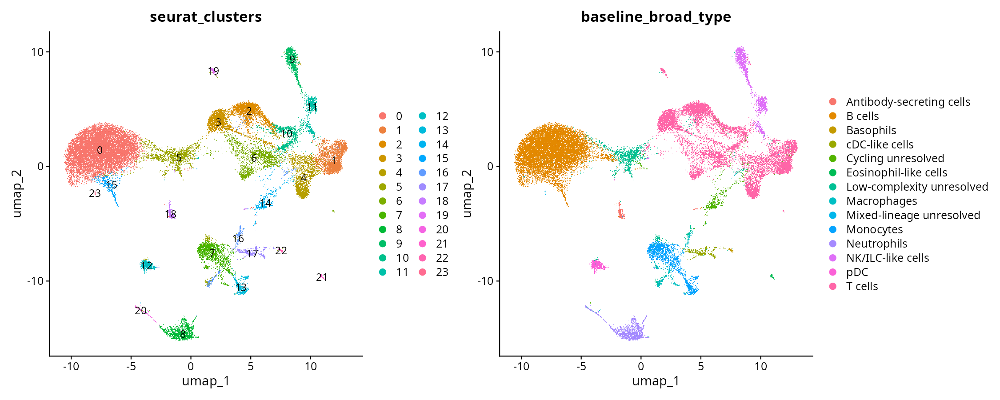
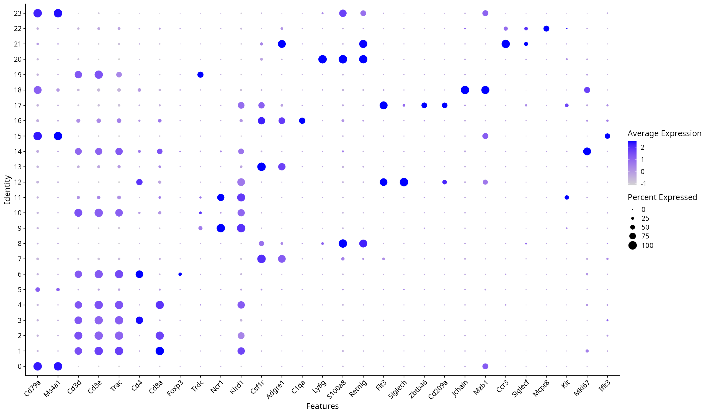
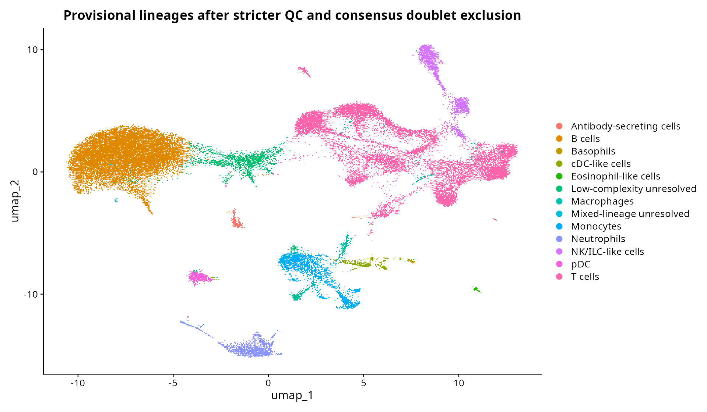

# Stricter QC, doublet sensitivity and reclustering

## Analysis choices

The baseline is preserved. A separate branch requires 500–6,000 detected genes and ≤20% mitochondrial counts, using the baseline QC gene universe. It is normalized and clustered again from raw counts. Statistical doublet detection then runs independently in the three GEO capture libraries, retaining the nine mouse tags as biological samples.

scDblFinder 1.22.0 with XGBoost 1.7.11.1 evaluates assumed residual doublet rates of 2.5%, 5% and 10%. These are stress scenarios after sample-tag filtering, **not measured BD Rhapsody loading rates**. Each uses the same seed, 1,352 selected features, 20 dimensions and 3,000 random artificial doublets per capture. Rate uncertainty uses the version-pinned default ±40% of the assumed rate. Scores are prediction scores, not calibrated probabilities. Calling thresholds optimize classification and need not yield the assumed percentage of calls.

The conservative exclusion branch removes only cells classified as doublets in **all three** scenarios. Cells called in a subset of scenarios remain flagged as rate-sensitive. A negative model call does not prove singlet status, especially for homotypic doublets, rare populations and ambient contamination. No original cluster is deleted wholesale.

## Cell accounting

| Stage | Cells |
|---|---:|
| Initial baseline QC | 55,634 |
| ≥500-gene branch before doublet exclusion | 46,954 |
| Consensus predicted doublets excluded | 2,766 |
| Retained after consensus exclusion | 44,188 |
| Retained rate-sensitive calls | 1,068 |

The stricter branch has 24 clusters; the consensus-filtered branch has 24. New cluster IDs are independent of baseline IDs. All nine mouse tags remain.

## Capture and rate scenarios

| Capture library | Assumed residual rate | Cells tested | Predicted doublets | Predicted % |
|---|---:|---:|---:|---:|
| GSM9868022 | 2.5% | 14,003 | 856 | 6.11% |
| GSM9868023 | 2.5% | 17,140 | 1,018 | 5.94% |
| GSM9868024 | 2.5% | 15,811 | 899 | 5.69% |
| GSM9868022 | 5.0% | 14,003 | 1,176 | 8.40% |
| GSM9868023 | 5.0% | 17,140 | 1,430 | 8.34% |
| GSM9868024 | 5.0% | 15,811 | 1,032 | 6.53% |
| GSM9868022 | 10.0% | 14,003 | 1,327 | 9.48% |
| GSM9868023 | 10.0% | 17,140 | 1,399 | 8.16% |
| GSM9868024 | 10.0% | 15,811 | 1,066 | 6.74% |

## Previously concerning clusters

| Baseline cluster | Passed ≥500 genes | Consensus doublets | Consensus % |
|---|---:|---:|---:|
| 1 | 1,223 | 2 | 0.2% |
| 4 | 848 | 22 | 2.6% |
| 11 | 1,278 | 1,262 | 98.7% |
| 12 | 842 | 56 | 6.7% |
| 20 | 322 | 4 | 1.2% |
| 25 | 41 | 0 | 0.0% |

The mixed B/T cluster was flagged independently by same-cell lineage-marker co-expression before modeling; compare its model enrichment here without treating the manual screen as ground truth. Statistical doublet detection is not a low-complexity filter. Low-complexity unresolved barcodes and rare B/granulocyte-program barcodes can remain even when not called doublets. These review flags must survive into subsequent annotation decisions.

## Sample retention

| Mouse tag | Baseline QC | ≥500 genes | Consensus excluded | Retained |
|---|---:|---:|---:|---:|
| tag01 | 4,654 | 4,654 | 326 | 4,328 |
| tag02 | 4,620 | 4,619 | 306 | 4,313 |
| tag03 | 4,734 | 4,730 | 221 | 4,509 |
| tag04 | 6,750 | 5,756 | 309 | 5,447 |
| tag05 | 6,848 | 5,659 | 326 | 5,333 |
| tag06 | 7,110 | 5,725 | 380 | 5,345 |
| tag10 | 6,518 | 5,179 | 334 | 4,845 |
| tag11 | 6,199 | 4,716 | 229 | 4,487 |
| tag12 | 8,201 | 5,916 | 335 | 5,581 |

## New clusters and marker review

Baseline labels shown in overlap plots are provenance only. They are not automatically transferred final annotations. Inspect new marker evidence and the new mapping document before freezing labels. Review remaining low-complexity cells, cycling lineage, NK/ILC-like cells and marker conflicts; do not interpret changing cluster numbers or UMAP geometry as treatment effects.

## Reproduce and audit

Restore `renv.lock` in a project-local environment. Run `bash scripts/run_sc_sensitivity.sh` from the repository root after a successful restore. The wrapper uses `scripts/run_r.R` to select the restored project library; direct `Rscript scripts/analysis.R` commands alone do not guarantee that the restored packages are selected. Apply the reviewed mapping with `Rscript scripts/run_r.R scripts/sc_annotate_sensitivity.R` when the saved cluster-assignment signature matches. The doublet stage checkpoints each capture/rate result and only reuses it when its input/configuration/dependency signature matches. `COMPLETE` files distinguish completed stages. Large Seurat objects remain outside version control.

The matching dependency versions were installed in an isolated library; shared R packages were unchanged. Preliminary models using a mixed preinstalled Bioconductor stack were superseded. The final package inventory, model session information and source archive checksums document the execution environment. A full fresh-environment restore remains a release check.

## Remaining inference limits

The residual doublet rate is unknown, discarded tag-multiplet expression is unavailable, and no unfiltered droplet matrix is supplied for validated ambient-RNA correction. Condition and capture library remain confounded. Within-mouse biological heterogeneity and injury-associated cell damage can affect retention. These analyses support QC and annotation; they do not establish a treatment effect.

Method: [scDblFinder](https://bioconductor.org/packages/scDblFinder/); capture-aware multiplexing and expected-rate handling are documented in the version-pinned package manual and source.

## Reviewed provisional mapping

All 44,188 retained cells have provisional annotations. 4,433 retain at least one review flag: an earlier unresolved-cell flag, a newly unresolved-cluster flag, or a rate-sensitive model call. These are review flags, not additional automatic cell exclusions. Prior flags survive even when cells move into a clearer new cluster.

The new cycling cluster has Cd3e in 82%, Trac in 85% and Mki67 in 92% of cells, supporting a T-enriched cycling identity. Low-complexity cells remain unresolved (new cluster 5; median 638 genes). The rare B/granulocyte-program population persists as new cluster 23 (36 cells), so it remains held. CD4/Treg, innate-like T and NK/ILC boundaries are still tentative; no treatment-effect conclusion follows from these state labels.

| New cluster | Cells | Provisional label | Confidence | Review status |
|---|---:|---|---|---|
| 0 | 17,102 | B cells | high | provisional_lineage |
| 1 | 3,205 | CD8 T cells (cytotoxic) | high | provisional_lineage |
| 2 | 2,662 | CD8 T cells | high | provisional_lineage |
| 3 | 2,435 | CD4 T cells | high | provisional_lineage |
| 4 | 2,404 | CD8 T cells (cytotoxic) | high | provisional_lineage |
| 5 | 2,361 | Low-complexity cells (unresolved lineage) | low | hold_low_complexity |
| 6 | 2,353 | CD4 T cells (Treg-enriched) | moderate | provisional_lineage |
| 7 | 2,047 | Monocytes/macrophage-like cells | moderate | provisional_lineage |
| 8 | 1,583 | S100a8+ neutrophils | moderate | provisional_lineage |
| 9 | 1,297 | NK cells | high | provisional_lineage |
| 10 | 1,124 | Innate-like T cells (subtype unresolved) | moderate | provisional_lineage |
| 11 | 915 | NK/ILC-like cells (subtype unresolved) | moderate | provisional_lineage |
| 12 | 640 | Plasmacytoid dendritic cells | high | provisional_lineage |
| 13 | 636 | Cd300e-like monocytes | moderate | provisional_lineage |
| 14 | 614 | Cycling T cells (CD8-enriched) | moderate | provisional_lineage |
| 15 | 611 | Interferon-response B cells | high | provisional_lineage |
| 16 | 578 | C1q+ macrophage-like cells | moderate | provisional_lineage |
| 17 | 510 | Conventional DC-like cells | moderate | provisional_lineage |
| 18 | 325 | Antibody-secreting cells | high | provisional_lineage |
| 19 | 261 | RORC+ T cells (gamma-delta-like) | moderate | provisional_lineage |
| 20 | 203 | Ltf/Ngp+ neutrophils | high | provisional_lineage |
| 21 | 160 | Eosinophil-like cells | moderate | provisional_lineage |
| 22 | 126 | Basophils | high | provisional_lineage |
| 23 | 36 | B cells with granulocyte program (unresolved) | low | hold_mixed_lineage |

The mapping is guarded by a SHA256 fingerprint of the cell-to-cluster assignments. If reclustering changes assignments, it must be reviewed again rather than silently reused.

